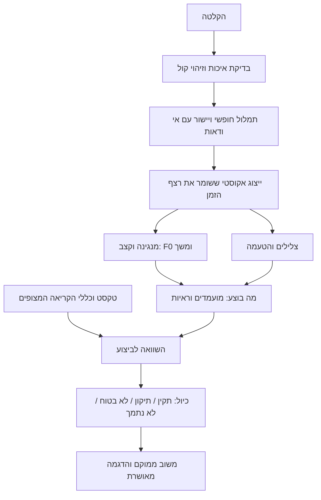

# Taamify — תוכנית מחקר וביצוע למערכת שעובדת על קריאה אמיתית

תאריך: 27.10.2026 · סטטוס: תוכנית מוצעת לדיון, לאחר בדיקת קוד, דאטה ומקורות מחקר.

**ההמלצה: להקדים סבב אבחון ותיקון של הנתונים ושל מסלול המשתמש לכל סבב אימון גדול. לבחור מודל לפי איכות המשוב על ביצועים שנבדקו בידי אדם, ולהשתמש במודלים קיימים כמתחרים וכרכיבים.** אין כרגע בסיס להבטחת שלמות או להכרזה שהמודל מתאים לכל קורא. יש בסיס לעבודה מסודרת שתזהה מה מתקלקל ותבדוק אם כל שינוי באמת עוזר.

המסמך מממש את הבקשה למחקר אקדמי ולמוצר עסקי באותו פרויקט. הוא משלים את תוכניות Research OS הקודמות ומשנה את סדר העדיפויות המוצע: לפני כיול נוסף ופריסה של משפחות מודלים רבות, בונים מבחן ביצוע אמיתי ומתקנים את מסלול הדאטה. הוראות ה־BEN13 והנוסח נשארות בתוקף עד החלטה מפורשת על הרחבת מקור שעבר ביקורת; אין כאן היתר לאמן על הקבצים הישנים של R1/R2/R8.

## 1. מה יהיה המוצר, ומה נחשב הצלחה

משתמש קורא קטע מהתורה בנוסח ספרדי־ירושלמי. המערכת מזהה מה בוצע בפועל, בודקת אותו מול הקריאה הנדרשת, ומחזירה הערה נכונה, ממוקמת ומועילה לתיקון. זיהוי טעם, זיהוי שגיאה והוראה מתקנת הן שלוש יכולות נפרדות. לא מסמנים את שלושתן כהצלחה בגלל מדד של אחת מהן.

בגרסה הראשונה: תורה, נוסח מוגדר, קריאה של משפטים קצרים, טעמים וערוצי הגייה שאומתו בנפרד. הפטרה, נוסחים נוספים, כל הטעמים הנדירים, הוראה אדפטיבית והכרעות הלכתיות אינם מקבלים הבטחת תמיכה אוטומטית. את גבולות התמיכה מציגים לפי ראיות, בלי להוריד בדיעבד דוגמאות קשות מהמכנה.

המבחן שהמשתמש צריך לראות הוא הקלטה והשוואה: מה אמר המורה, מה אמרה הגרסה הקיימת, מה אמרה המועמדת, ואיפה באודיו נמצאת הסיבה. בנוסף מציגים סיכום על כל המדגם, כולל הכישלונות. סרטון של שלוש הצלחות אינו מבחן קבלה.

| דרישת שטח | איך בודקים | יעד התחלתי מוצע, לא תוצאה קיימת |
|---|---|---|
| כשהמערכת מתקנת אותי, היא בדרך כלל צודקת | מורה בודק את ההערות שהוצגו על קריאה טבעית | לפחות 95% מההערות נכונות; לדווח גם על אי־ודאות באומדן |
| המערכת מוצאת טעויות אמיתיות | כל הטעויות שהמורה סימן הן המכנה, גם בקטעים שהמערכת דחתה | גילוי של לפחות 70%, בנפרד לפי סוג וחומרה |
| קריאה נכונה אינה נענשת | מספר התרעות שווא מתוך כל היחידות התקינות, ולצדו מספר סשנים עם התרעת שווא | תקרת 2% ליחידה, עם רווח סמך; המדד לבדו אינו מספיק |
| המערכת אינה מתחמקת מרוב הבדיקה | שגיאות יישור, קלט שנדחה, טעם לא נתמך ו״לא בטוח״ נשארים בדוח | לפחות 80% מהיחידות בתחום התמיכה מקבלות הכרעה שימושית |
| ההערה ממוקמת ומסבירה מה לתרגל | בדיקת מורה של המילה, ההברה/הצליל, ההדגמה והוראת התיקון | לפחות 90% מהתיקונים נכונים גם במיקום ובסוג, כיעד פיילוט |
| התגובה מגיעה בזמן שימושי | זמן מסיום ההקלטה עד להצגת המשוב בדפדפן | יעד פתיחה: p95 עד 3 שניות לקטע של 5–10 שניות בחומרה המוגדרת; למדוד לפני התחייבות |
| ילדים וקוראים חדשים מקבלים שירות טוב | פירוט לפי קורא, ניסיון, גיל ותנאי הקלטה | אין הבטחה לילדים על סמך מבוגרים בלבד |

אלה **שערים משותפים**. אי אפשר לעמוד בדיוק ההערות באמצעות שתיקה כמעט תמיד, או לעמוד בגילוי באמצעות סימון כולם כשגויים. נשמור גם F1 ומדדים מדעיים לצורך אבחון, אבל הם אינם מחליפים את השערים.

למה 2% התרעות שווא עדיין עלולים להרגיש גרוע: בדוגמה חשבונית של 1,000 מילים, אם יש 50 טעויות ומגלים 35 מהן, 2% התרעות על 950 המילים התקינות מוסיפות 19 תיקונים שגויים. רק 35 מתוך 54 ההערות מוצדקות — כ־65%. לכן צריך לבדוק במפורש את אמינות ההערות בשכיחות הטעויות של משתמשים, ולא רק על מבחן מאוזן מלאכותית.

## 2. מה כבר נמצא, ומה עדיין השערה

הבדיקה החדשה ניתנת לשחזור באמצעות `research_os/audit_research_readiness.py`; פירוט המקורות והגבולות נמצא ב־[תיק הראיות](RESEARCH_EVIDENCE_20261027.md).

| ממצא | מה הוא אומר | פעולה |
|---|---|---|
| 47 טביעות ספקטרוגרמה זהות משותפות ל־train ול־validation; 5,817 בלוקי מקור משותפים | הוולידציה אינה עצמאית ברמת ההקלטה | פיצול מחדש בקבוצות לפני בחירת אפוק/מודל |
| לא נמצאו טביעות ספקטרוגרמה זהות בין train ל־test; גם אין בלוקי מקור משותפים בדוגמאות שמקורן יחיד | אין הצדקה לטעון שכל הטסט דלף לאימון | לשמר את הממצא; לבדוק בנפרד כפילויות אודיו ומקורות עמומים |
| בדוח הקיים: Segol זוהה נכון 29 פעמים מתוך 255 תחזיות Segol | ממוצע גבוה מסתיר מחלקה עם precision של כ־11.4% | לבנות תיק תקלות ייעודי, לא להסתפק ב־macro-F1 |
| 1,161 מתוך 10,274 דוגמאות טסט שמופו חד־משמעית הן עם משך מטא־נתונים מעל 2.784 שניות; הקוד משאיר 87 פריימים | קיים חשד לאובדן חלק מזנב הנגינה; זו עדיין אינה מדידת הנזק | לבדוק חיתוך מול אודיו מלא, זמנים ומורה |
| אין יומן collected_phrases מקומי; יש 15 ניסיונות בודדים ללא תווית ביצוע אנושית ביומן | עדיין אין מאגר טעויות לומד מוכן להערכה | שימוש מקומי לאבחון בלבד, בירור מקור והרשאה לפני מחקר/אימון |
| practice.html לא שולח consent ו־voice_id למסלול המשפטים | השימוש במסך זה אינו מפעיל את לולאת איסוף המשפטים | מסלול איסוף מפורש ומדוד, ללא שמירה סמויה |
| ingest ממשיך כשאין training_safe.json; voice_intake לא בודק נוסח בפונקציית המיון | ההגנות המתוארות בתיעוד אינן נאכפות במלואן | כשל סגור, אישור מקור ותוויות ביצוע לפני קליטה |
| דגש משתנה בבדיקה עם שני סדרי יוניקוד שקולים | באג בשכבת הציפייה הטקסטואלית | פענוח סימנים לפי אות בסיס; בדיקות אינווריאנטיות |
| הטקסט צפוי, היישור מאולץ, מודל הרצף משפיע על החיתוך ועל האימות | ייתכן תיקון אוטומטי של הטעות לפני שהיא מדווחת | ניסוי אקוסטי/הקשר על טעויות שבוצעו בפועל |
| מסכי single-word, phrase ו־practice משתמשים במסלולי ציונים שונים | מבחן של endpoint אחד אינו מוכיח את המסך שהמשתמש מפעיל | מבחן חוזר באותו מסך, עם אותו קובץ וגרסאות מזוהות |

**לא הוכח עדיין** איזה חלק מהכישלון האישי של המשתמש נובע מהקלטה, יישור, זהות קול, הגייה, נוסח, תוויות או מדיניות הציון. לא נשמעו ונשפטו כאן הקלטותיו בידי מורה. אסור להציג את ההשערות האלה כאבחנה סופית.

ה־F1 המחושב מהדוח תקין חשבונית. הוא מתאר זיהוי מחלקות על נתוני בן13. הוא אינו אומדן של אמינות תיקוני המוצר על משתמש חדש.

## 3. מה לומדים מהמחקר, ומה מאמצים בפועל

### 3.1 זיהוי דיבור אינו זהה לבדיקת הגייה

[סקירת Automatic Pronunciation Assessment](https://aclanthology.org/2023.findings-emnlp.557/) מפרידה בין הערכה פונטית לפרוזודית. ניישם הפרדה דומה: צלילי אותיות ותנועות, הטעמה, מנגינת הטעם, הפסקות ומילים חסרות. ראש סיווג בינארי יחיד לכל אלה אינו תוכנית מספקת.

[Intent vs. Surface, BEA 2026](https://aclanthology.org/2026.bea-1.23/) מדגים באנגלית ש־ASR עם תמלול טוב יותר עלול להסתיר יותר שגיאות הגייה. גם הפתרון שנבדק שם משאיר שגיאות רבות ואף מגדיל חלק מהתרעות השווא. היישום שלנו הוא מבחן נאמנות לביצוע, לא הבטחה שהעתקת האלגוריתם תפתור טעמים בעברית.

### 3.2 לקחת את תהליך הכנת הדאטה של הטכניון, ולבחון את המודל בנפרד

[פרויקט SIPL מ־2025](https://sipl.ece.technion.ac.il/projects/project-details/?prj_id=11111) משלב VAD, תמלול ראשוני ויישור הדרגתי לטקסט המקראי. זה בסיס שימושי לייבוא הקלטות ארוכות. הוא אינו הוכחה שדאטה חדש נכון רק מפני שהיישור הצליח.

הפייפליין המוצע: מקור מזוהה → זיהוי נוסח וקורא → חיתוך למשפטים עם שוליים → תמלול חופשי → התאמה למיקום במקרא → יישור מקומי → בדיקת אי־התאמות → אישור אדם/דירוג איכות → manifest → חלוקה לפני יצירת נגזרות → אימון.

המודל המוכן הירושלמי של Whisper-small הוא מתחרה ראשון ראוי לבדיקה. Tiny כבר עבר אצלנו בדיקת הרצה על קטע אחד; זו אינה הוכחת דיוק. אין צורך לאמן Whisper מאפס. קוד הטכניון, משקולותיו ומקורות האודיו דורשים בדיקות רישוי נפרדות. לא מעתיקים אוטומטית את פיצול הדאטה שלהם: בקובץ split שנבדק אין הבטחה להפרדת קוראים, ואין ממנו ראיה לפרוטוקול של התוצאה המדווחת ב־2025.

### 3.3 מחקר קריאה בקוראן מספק מסגרת בדיקה שימושית

[QuranMB/IqraEval, Interspeech 2025](https://www.isca-archive.org/interspeech_2025/elkheir25b_interspeech.pdf) מציע תוויות פונטיות, הערכת גילוי ואבחון, ומודלי SSL עם ראש רצפי. יש מגבלה חשובה: מבחן המאמר כולל טעויות מכוונות שנקראו בידי אנשים, ובהנחיה לקרוא ללא כללי tajweed; הוא אינו הוכחת זיהוי מנגינות. נאמץ את מבנה ההערכה, ונפריד אצלנו טעויות מכוונות מטעויות טבעיות. משקולות ערביות אינן מודל טעמים עברי מוכן.

### 3.4 מחסור בדאטה אינו מחייב אימון גדול מאפס

[מחקר Finland Swedish מ־2025](https://www.isca-archive.org/interspeech_2025/phan25_interspeech.pdf) מראה שאפשר לחקור גילוי טעויות באמצעות דיבור תקין ומעט חומר לומדים לבדיקה. הביצועים שם עדיין מוגבלים. נשתמש בעיקרון כדי להתחיל בניסוי קטן, בלי להבטיח שהקלטה של קורא יחיד תספיק להכללה.

## 4. מערך הנתונים: איך מתקדמים גם עם קורא אחד

### ארבעה מאגרים נפרדים

1. **נתוני מורה תקינים:** בן13 והרחבות עתידיות מאומתות. מיועדים ללמוד מימושים תקינים. לכל דוגמה נשמר מקור, נוסח, קורא, טקסט וחיתוך.
2. **תיק תקלות לפיתוח:** דוגמאות שהמערכת נכשלת בהן, כולל הקלטות משתמש מאושרות. מותר להסתכל שוב ולתקן לפיהן; לעולם אין לכנותו טסט סופי.
3. **מאגר ביצועים מתויג:** ביצוע תקין, טעות טבעית, טעות מכוונת, ביצוע עמום וקלט שאינו קריאה. כאן לומדים ומכיילים את החלטת התיקון.
4. **מבחן סופי שמור:** קוראים וסשנים חדשים, ללא תיוג באמצעות תחזיות המודל. אין בחירת מודל או סף על סמך תוצאותיו.

כל רשומה כוללת לפחות: `sample_id`, `source_root_id`, `speaker_id` בדוי, `session_id`, נוסח, פרשה/פסוק/בלוק, מכשיר, hash אודיו, קצב דגימה, גבולות, טקסט מצופה, תמלול ביצוע, טעם מצופה, טעם/קבוצת מימושים שנשמעו, סוג טעות, תקינות, חומרה, ביטחון מתייג, זהות מתייג בדויה, סטטוס הסכמה/מקור, split וגרסאות הכלים. שדות שלא נבדקו נשארים לא ידועים; לא ממלאים אותם מהטקסט.

מבדילים בין ארבע רמות תווית: expected-from-text, pseudo-label, human-reviewed, adjudicated. רק האחרונה משמשת אמת מידה סופית. מקצועיות הקורא אינה מבטלת בדיקת מיפוי טקסט/אודיו.

### תוכנית מינימלית שאינה תלויה בגיוס גדול

**מיידית, עם הקיים:** לשחזר פיצולים, לתקן תיוג, לבדוק חיתוכים, למפות כשלים, להשוות מודלים על אותם קטעים ולבדוק עמידות לרעש ולקצב. אפשר לשפר הרבה דברים בלי קורא נוסף. התוצאה נשארת מוגבלת לקול ולתנאים שנמדדו.

**אבחון אישי, כאשר זמינה הקלטה:** המשתמש יכול להיות קול אבחון נוסף גם אם אינו מורה. צריך לתייג את הביצוע שלו, לא להניח שכל מה שקרא נכון. סט מוצע: 24 משפטים, בשני סשנים — חלקם טבעיים וחלקם זוגות ביצוע תקין/שגיאה מבוקרת בהנחיית מורה. אין חובה לכלול טעות שהקורא אינו מסוגל לבצע. שימוש בדוגמאות האלה לפיתוח הופך את המשתמש לקורא מוכר לפיתוח, לא למבחן הכללה סופי.

**מאמץ אנושי קטן ממוקד:** עדיפות ראשונה לשעת תיוג/האזנה של מורה בעל קריאה בנוסח הרלוונטי, במקום לגיוס שעות רבות ללא תוויות. שני שופטים על קבוצת העוגן ועל מחלוקות; מורה אחד מספיק לפיילוט אבחון אך לא להכרזה על הסכמה בין מומחים.

**הרחבה בשלבים:** פיילוט של 4–6 קוראים נועד לגלות תקלות, ולא להוכיח התאמה לכלל האוכלוסייה. יעד תכנון למחקר מאשש: 12–20 קוראים, עם חלוקה לפי קורא, ניסיון וסשן וקבוצת מבחן שאינה משתתפת בכיול. זה אינו חישוב עוצמה סטטיסטית ואינו מספר קסם; אחרי הפיילוט קובעים גודל לפי שונות בין קוראים, שכיחות טעויות וטעמים נדירים. מעט מילים מאנשים רבים עדיפות לעוד אלפי חזרות מאותו קול לצורך בדיקת הכללה.

**אם אין בכלל גישה לקול חדש או למתייג:** ממשיכים באבחון הנדסי, בתיקון הדאטה ובמחקר על אותו קול; לא מציגים זאת כמוצר שנבדק על תלמידים. מודל מאומן מראש הוא דרך לקבל ידע אקוסטי נוסף, אבל אינו מייצר הוכחת שימוש שלא נאספה.

### מה פותחים מחדש, ומה נשאר בחוץ

- האיסור המעשי על הקבצים הרועשים הישנים מוצדק; המסקנה ״עוד קוראים מזיקים״ אינה מוצדקת מהניסוי ההוא בלבד. יש מקום להצעת ניסוי חדשה: חומר המקור של קוראים באותו נוסח, יישור מחדש, ביקורת ידנית, ואז השוואה באותה כמות מילים ובאותו פרוטוקול. לא משתמשים שוב בחיתוכים הישנים.
- נוסח אחר אינו תוספת אוטומטית של תוויות למנגינה הירושלמית. אפשר בעתיד לבדוק pretraining כללי או מודל מותנה בנוסח, עם הפרדה מפורשת. זו שאלה אחרת מהוספת נתונים לאותו מסווג.
- Ben13, הקלטות ישירות, ארכיוני קריאה והמשאבים בקוד הטכניון הם מועמדים לבדיקה לפי מקור. מספר שעות זמין באתר אינו מספר שעות מאושרות, בנוסח מתאים ועם קוראים עצמאיים.
- שינוי pitch, קצב או מיקרופון אינו קורא חדש. Voice Conversion הוא ניסוי מאוחר עם בדיקת שימור מנגינה; לא פתרון היסוד למחסור בדוברים.
- שגיאות שנוצרו ב־TTS או עריכה מוזיקלית יכולות לעזור באימון ובבדיקות מאמץ. בטסט המאשש משתמשים בביצועים אנושיים, ומפרידים טבעי ממכוון.

## 5. תיוג ומוזיקולוגיה: להגדיר מה באמת אפשר לשמוע

לפני אימון נוסף, מורה בנוסח הרלוונטי מגדיר עבור כל משפחת טעמים: מימושים מותרים, תלות במשרת/מפסיק הסמוך, שינויי מנגינה לפי הקשר, גבולות המליסמה, מיקום ההטעמה וטעות שמצדיקה תיקון. סימן טעם כתוב אינו בהכרח יחידת צליל עצמאית ומבודדת. אין לאחד מחלקות רק משום שהמודל מתבלבל, ואין לחייב הפרדה אקוסטית שאנשי מקצוע אינם מצליחים לבצע.

תוכנית ביקורת ראשונית: עד 200 יחידות פיתוח — 60 מהבלבולים אתנחתא/סגול ומונח/קדמא, 40 מטעמים נדירים, 40 ממקרים של דחיית יישור/משך חריג, 40 מערוצי הגייה ו־20 הצלחות אקראיות. מחסור בקבוצה נרשם, בלי לשכפל דוגמאות כדי למלא מכסה. המדגם מוטה במכוון לצורכי אבחון; אין לדווח ממנו דיוק אוכלוסייה.

כל יחידה נבדקת בשתי צורות: עם הקשר של משפט, ובהאזנה ממוקדת למקטע. אין להראות למתייג את תחזית המודל. תחילה מסמנים את הביצוע, לאחר מכן את היחס לקריאה הנדרשת. מתעדים מחלוקת ו״לא ניתן להכריע״; לא מוחקים אותן כדי להעלות הסכמה. דגש קל, שווא, עי״ן/אל״ף והטעמה דורשים הגדרות ומיקומי יעד נפרדים, כולל שונות מותרת בתוך הנוסח. חומרה הלכתית והנחיית ״צריך לחזור״ דורשות אישור תוכן מקצועי.

## 6. הארכיטקטורה המוצעת לבדיקה

זו משפחת מועמדים לניסוי, לא התחייבות לבנות את כל הרכיבים לפני בדיקת תועלת. מותר לטקסט לסייע במיקום ובפירוש; אסור שהציפייה לבדה תיחשב ראיה לביצוע. מסלול אקוסטי ללא הטעם המצופה נדרש לצורכי בקרה, גם אם המוצר הסופי משלב הקשר.

| רכיב | מועמד מעשי | מה חייבים להוכיח |
|---|---|---|
| בסיס השוואה | ה־CNN וה־API הנוכחיים, מזוהים ב־hash | שחזור מלא של החלטות על קלט קבוע |
| זיהוי טעמים מוכן | Whisper-small הירושלמי שפורסם; Tiny לבדיקות טכניות | שהוא מחזיר את הביצוע גם כשאינו קנוני; חפיפת Ben13 מסומנת |
| ייצוג דיבור | תחילה ה־wav2vec2 העברי שכבר מקומי; אחר כך W2v-BERT 2.0 | ראש רצפי קטן על ייצוג קפוא; יתרון על המקרים הקשים באותם חיתוכים |
| ייצוג מוזיקלי | pYIN קיים מול torchcrepe, עם voiced mask וביטחון | פחות שגיאות אוקטבה ואובדן תנועת מנגינה; לא להסיק זיהוי טעם מגובה קול בלבד |
| מודל זמן | TCN/GRU קטן או attention עם מסכת אורך | שיפור לעומת pooling ממוצע; לא למחוק את סדר העליות והירידות |
| אימות | השוואת ביצוע–ציפייה עם שלוש הכרעות לפחות | זיהוי טעויות אמיתיות ללא אישור אוטומטי דרך ההקשר |
| הגייה | ראש על אזור הפונמה/ההברה הרלוונטית | הבחנה באותו תוכן לקסיקלי עם ביצוע שונה |
| הסבר | תבניות משוב מאושרות ודוגמת מורה תואמת | הסבר נכון לממצא; LLM אינו ממציא טעות או פסק הלכתי |

נשמור F0 יחסי בסמיטונים וגם מידע זמן מקורי, משך, אנרגיה ומסכת קוליות. לא נמתח את כל המילים לאורך אחיד בלי לבדוק אם כך נמחק מידע. ממוצע עקומות של טעם עשוי להיות מנגינה שאיש לא שר; עדיף לבחון דוגמאות מורה מייצגות ותלויות הקשר.

WavLM הוא מועמד משני, לא ברירת מחדל: כרטיסו מתאר גם שימור זהות דובר ואימון באנגלית. MuQ/מודלי מוזיקה גדולים, Voice Conversion, adversarial learning ואנסמבלים רחבים נדחים עד שהניסויים הזולים מצביעים על תועלת אפשרית. רישיון וצריכת זיכרון נבדקים לכל משקולת בנפרד.

## 7. עשרת הניסויים שיכריעו מה לבנות

הניסויים מסומנים N01–N10 כדי לא להתבלבל עם P00–P12 הישנים. פיילוט אחד הוא חקרני. מאששים רק משפחה מצומצמת של מנצחים, על קבוצות עצמאיות ועם כמה seeds.

| ניסוי | שאלה ופעולה | בקרה | החלטה בסיום |
|---|---|---|---|
| N01 — שרשרת הקלט | אותו WAV ישירות ל־API ומסלול קובץ דרך הדפדפן; בדיקת sample rate, אורך ו־PCM. בנפרד: הקלטה חדשה במיקרופון | קובץ ידוע, שקט, עוצמות שונות, דפדפנים | אם הבתים/הפיצ'רים משתנים בלי כוונה — מתקנים לפני השוואת מודלים |
| N02 — תוויות וחיתוך | 200 יחידות הביקורת; גבולות אוטומטיים מול גבולות אנושיים; קטע מלא מול חלון נוכחי | אותו מודל בדיוק, אותה רשימת יחידות | שיפור בחיתוך ידני מזהה צוואר בקבוק upstream; לא מחייב שהמסווג טוב מספיק |
| N03 — השפעת הקשר | inference ללא הקשר, עם הקשר, וללא best_shift; תחילה גבולות זהים וקבועים, אחר כך כל מסלול מלא | אותה הקלטה תקינה ושגויה, אותו טקסט; בקרה טקסטואלית בלבד | אם הקשר מסתיר טעויות — מחלישים/מפרידים אותו בהחלטת התיקון |
| N04 — מה באמת מבדיל טעם | CNN, מנגינה בלבד, תוכן דיבור בלבד, ושילוב | אותו חיתוך, קיבולת דומה, אותו split; F0 אפס/משובש כבקרה | רק רכיב שמוסיף מידע מעבר לבקרה נשאר |
| N05 — מודל מוכן | הירושלמי המוכן מול המערכת המקומית על אותם משפטים | ללא מסירת הטעמים המצופים לפענוח; תיעוד overlap | לבחור אם להחליף רכיב, להשתמש כמורה חלש או לדחות; הצלחה על Ben13 לבדה אינה ניצחון |
| N06 — Transfer learning | encoder מקומי קפוא + ראש רצפי; אחריו W2v-BERT אם מוצדק; רק אז fine-tuning חלקי/LoRA | encoder קפוא מול מופשר באותם תקציב ודאטה | אין מעבר למודל גדול בגלל גודל בלבד |
| N07 — Precision של המחלקות החלשות | בחינת תוויות Segol/Qadma; CE רגיל מול משקלי מחלקות מתונים/קיימים | נתוני פיתוח, בלי לבחור לפי הטסט הישן | למדוד false positives, recall וכיול; לא לייחס מראש את הכשל למשקלים |
| N08 — הרחבת קוראים מבוקרת | מקור נוסף נקי באותו נוסח, אם זמין ומאושר; fixed-total-data וגם add-data | BEN13 בלבד; קורא חדש שמור; אותו aligner | להפריד השפעת כמות, איכות, קורא ונוסח; לכמת עקומת למידה |
| N09 — Augmentation | רעש חדר/מיקרופון, קצב מתון ושינוי גובה קול בנפרד | ללא augmentation; אותן נגזרות באותו split | משאירים רק שיפור על הקלטות אמיתיות; אין ספירת קולות סינתטיים כדוברים |
| N10 — מדיניות המשוב | ספים על calibration בלבד; כל ערוץ וגם התוצאה הכוללת | גרסה קיימת מול מועמדת באותה שכיחות טעויות | בחירה לפי אמינות הערות, טעויות שנתפסו, כיסוי ותועלת הוראתית יחד |

כאשר אומרים ״הקשר״, מפרידים בין מודל רצף אקוסטי לבין הטקסט המצופה. המימוש הקיים מזין למודל הרצף embeddings אקוסטיים, לא ישירות את הפסוק; החשד הוא להעדפת רצף קנוני, ולא טענה שהמודל קיבל תווית תשובה ישירות.

## 8. פיצולים והערכת מחקר שאפשר להגן עליה

- משמרים רשימת sample IDs בכל חלוקה. כל נגזרת אודיו נשארת עם המקור; hash זהה/כמעט זהה, סשן ובלוק לא עוברים צדדים. טקסטים חופפים נמדדים במפורש, ולא מוסתרים.
- בנתוני קורא יחיד: train, development ו־calibration בקבוצות שונות של הקלטות/פסוקים, עם מבחן פרשות מתועד. אין מכאן טענה על דוברים חדשים.
- בנתונים מרובי קוראים: folds חיצוניים לפי קורא; פיתוח וכיול מתוך הקוראים המותרים בלבד. סשנים ופסוקים מותאמים נשמרים לבדיקה של העברת קול בנפרד מהעברת תוכן.
- הטסט הישן שנבדק שוב ושוב הוא benchmark היסטורי. לא ״מאפסים״ את הידע שנצבר עליו באמצעות שינוי שם. ההשוואה הסופית צריכה חומר חדש/שמור.
- מונים בנפרד טבעי, שגיאה מכוונת, label-swap וסינתטי. label-swap מועיל לבדיקת התאמה בין צליל לתווית, אך אינו מודד תלמיד ששר לא נכון בתוך משפט.
- הערכת ASR כוללת תמלול מה שנאמר ולא רק מרחק מהפסוק הקנוני. דילוג, חזרה, תוספת, הפסקה ומילה אחרת אינם נעלמים בתוך forced alignment.
- שלושה seeds לפחות למועמדים הסופיים; השוואה זוגית על אותם קוראים. רווחי סמך בקיבוץ לפי קורא/סשן, עם מגבלת אי־ודאות מפורשת כשמספר הקוראים קטן.
- כלל ה־2.3 נקודות הישן, המבוסס על שונות seeds בניסוי אחד, אינו חוק סטטיסטי כללי. מחשבים שונות והשפעה בניסוי הנוכחי; seeds אינם תחליף למספר בני אדם.
- AUC, MCC ו־F1 נשמרים כמדדים מסבירים. ההחלטה נשענת גם על confusion לפי טעם, precision של הערות, כיסוי, סשנים שנכשלו וטעות בלתי מוצדקת בעלת חומרה גבוהה.
- מקבעים מראש יעדים ראשיים, החרגות, stop/go ושימוש בטסט. פתיחת טסט סופי נותנת החלטה; המשך תיקון אחריו מחייב גרסת מבחן חדשה.

## 9. מסלול עבודה, תלויות ותוצרים

האומדנים הם ימי עבודה ממוקדת, לא מדידת זמן GPU ולא התחייבות למסירה. איסוף וביקורת אנושית יכולים לשנות את לוח השנה. אפשר לעבוד על הנדסה ועל תכנון איסוף במקביל בלי לערבב תוצאות.

| חבילה | פעולות וקבצים מרכזיים | אחריות | תוצר ותנאי מעבר | אומדן |
|---|---|---|---|---|
| W00 — הקפאת בסיס | זיהוי כל checkpoint, encoder, frontend, thresholds ו־endpoint; שמירת הראיות הקיימות | סוכן הנדסי | baseline manifest עם hashes; אין ״מודל נוכחי״ עמום | חצי יום–יום |
| W01 — תשתית אמת | `00_validate_and_prepare_data.py`, manifest ו־split לפי קבוצות; איתור כפילויות; אי־דריסת גרסאות | סוכן הנדסי | IDs לכל שורה; אפס חפיפות אסורות; בדיקת כל שרשרת המודלים | 2–4 ימים |
| W02 — קליטת דאטה | `voice_intake.py`, `ingest_collected_phrases.py`, מסך הקלטה בהסכמה; מסלול תיקון תוויות | סוכן + בעלים | מקור חסר/נוסח חסר/אישור חסר אינו נכנס לאימון; תווית ביצוע אינה נלקחת אוטומטית מהמצופה | 1–3 ימים |
| W03 — ניתוח תקלות | N01–N03, 200 יחידות ביקורת, שחזור תקלות המשתמש | סוכן + מורה | לכל כשל: עדות, רכיב חשוד, בדיקה מפריכה וסיבת תיקון | 3–5 ימים, בכפוף למתייג |
| W04 — ציפייה טקסטואלית | Unicode, מקף, טעמים כפולים, הטעמה, דגש ושווא; גבולות התמיכה | סוכן + מורה | בדיקות קצה; כללים מאושרים; עמימות מדווחת | 2–4 ימים |
| W05 — תחרות מועמדים | N04–N07; cache לייצוגים קפואים; מודל מוכן מול מקומי | סוכן מחקר | טבלת ניסויים על אותם קלטים, עלות, כישלונות ומועמד עדיף או החלטת ״אין שיפור״ | 4–8 ימים לאחר W01/W03 |
| W06 — הרחבת דאטה | מקורות מתועדים, מטריצת קוראים, תיוג כפול, N08–N09 | בעלים/מורה + סוכן | gold dataset לפי מקור; מבחן קוראים שמור; אין תלות במספר שעות שרירותי | מתחיל בשבוע הראשון; משך תלוי בגישה |
| W07 — אימות וכיול | N10, התאמה לשכיחות טעויות, תיעוד הימנעות והערות שווא | סוכן + מורה | precision/recall/coverage וכלל הסשנים עומדים יחד בשערים המוסכמים | 2–4 ימים אחרי נתוני ביצוע |
| W08 — מוצר | חיבור מועמד לשרת בדיקה; חבילת משקולות אחת; UX משוב/תיקון; בדיקות דפדפן אמיתיות | סוכן + משתמש | אותן החלטות offline/API/UI, זמני תגובה, rollback, אין הצלחה מדומה כשערוץ חסר | 3–5 ימים |
| W09 — מחקר מאשש | הקפאת פרוטוקול ומועמד, פתיחת מבחן שמור, ניתוח וכתיבה | סוכן + אחראי אקדמי | ראיות לכל טענה, טבלאות לפי קורא, מגבלות ושחזור | 5–10 ימים, אחרי W06–W08 |
| W10 — פיילוט ולמידה | סשני שימוש, ביקורת מורה, בדיקת תיקון חוזר ושימור למידה | משתמשים + מורה + סוכן | שיפור ביצוע בפועל; תיעוד נטישה/בלבול/חוסר אמון; החלטת שחרור | 2–4 שבועות פיילוט |

**תוכנית 12 שבועות מותנית:** שבועות 1–2 בסיס, תקלות ותיוג; 3–4 מועמדים והרחבת מקור; 5–8 ניסויי קוראים, תיקונים וכיול; 9–10 אינטגרציה ומבחן שמור; 11–12 פיילוט ומסמך מדעי. אין טעם להתחייב לפרסום או למוצר כללי בתאריך הזה אם הגישה למתייגים/קוראים אינה נפתרת. לעומת זאת, יש לצפות לתיק תקלות ולתיקונים הנדסיים בתוך הסבב הראשון.

## 10. חמשת ימי העבודה הראשונים

1. **יום 1:** להקפיא baseline, לשמר את דוח השחזור החדש, למפות את מסך המשתמש בפועל ולבנות רשימת תקלות מנוסחת כבדיקות. לתקן קודם כשלי קליטה והוכחות תאימות checkpoint — בשינוי נפרד לסקירה.
2. **יום 2:** להפיק manifest עם מקור לכל דוגמה ופיצולי קבוצות; להוציא רשימת חריגי משך/חיתוך וכפילויות. להכין חבילת ביקורת של עד 200 יחידות בלי להציג תחזיות למורה.
3. **יום 3:** לתקן parser של סימני הקריאה ולהריץ N01/N02 על החומר שכבר תויג. אם אין תיוג אנושי עדיין, להשלים בדיקות קלט, provenance וחיתוך מבני בלי להמציא תוצאות שמיעה.
4. **יום 4:** להריץ N03 ו־N05 על קבוצת האבחון הזמינה: מקומי מול מודל מוכן, עם/בלי הקשר. גם תוצאה של ״שניהם כושלים״ היא הכרעה מועילה אם יודעים באילו דוגמאות ולמה.
5. **יום 5:** להציג תיק השוואה: הקלטה, תווית אדם, לפני/אחרי, כשל שנותר והצעד הבא. לבחור לכל היותר שתי משפחות להמשך. אין פתיחת עוד עשרה תורים כדי לחפש מספר יפה.

## 11. איך מפסיקים לבזבז מחשוב

- לכל ריצה נכתבים מראש שאלה, נתונים, בקרה, תוצר והחלטה שתשתנה בעקבותיה. ריצה שלא תשנה החלטה אינה נכנסת לתור.
- מתחילים ב־inference וב־frozen features. שומרים cache לפי hash של אודיו, encoder ו־frontend; אין חילוץ מחודש לכל head.
- פיילוט מודל: בדיקת 32–64 דוגמאות לאיתור באג, אחריה תת־מדגם פיתוח קבוע ומייצג. overfit על מדגם קטן הוא בדיקת יכולת הנדסית בלבד, לא מדד איכות.
- תקציב מוצע לפיילוט: עד 30–60 דקות לריצה ראשונה לאחר מדידת throughput. אם אינו מספיק כדי ללמוד, מדווחים ״לא הוכרע במסגרת התקציב״; לא פוסלים משפחה לפי שני אפוקים שרירותיים.
- מכשיר MPS אחד: מתחילים בעבודה כבדה אחת, עם threads מוגבלים. לא מניחים ששישה מודלים במקביל הם פי שישה תפוקה.
- profiling של זמן חילוץ, זמן אימון, RAM, I/O וזמן inference קודם לתכנון שעות. מאיצים רבים/ענן/שירות בתשלום אינם דרישת קדם לאבחון הזה.
- מעבירים לאימון מלא רק משפחה שעברה תקינות דאטה, parity ותועלת בפיתוח. עוצרים כשיש סימן לקיצור דרך, אי־שחזור, או פגיעה ב־precision של המשוב.

## 12. מה צריך להשתנות במוצר

1. חוזה הכרעה אחיד לכל המסכים: תקין, טעות שניתן להסביר, לא בטוח, לא נתמך וקלט שלא ניתן לנתח. ציון sigmoid אינו ״אחוז הקריאה הנכונה״.
2. כל תשובה נושאת מזהה גרסת מודל/כיול/כללים; לוג אבחון מפריד הקלטה, יישור, חיתוך, זיהוי, החלטה והצגה. המידע הפרטי נשאר מקומי.
3. השרת טוען חבילת רכיבים תואמת לפי hashes, כולל sequence tagger, verify head והכיול. שם קובץ או אותה רשימת מחלקות אינם הוכחה לתאימות embeddings.
4. שגיאת יישור אינה נוזפת אוטומטית בקורא. בודקים שקט, clipping, אי־התאמת טקסט, השמטה וחזרה; מחזירים סיבה רק כאשר זוהתה.
5. משוב ממוקד: מילה מודגשת, השמעת הביצוע, הדגמה תואמת והנחיית תרגול אחת מאושרת. לא מפרשים צבע ירוק כהסמכה כללית לכל הקריאה.
6. לצד איסוף דוגמאות קשות, דוגמים בהסכמה גם חלק מהקריאות שאושרו. אחרת אי אפשר לגלות אישורים שגויים או למדוד שכיחות טעויות טבעית.
7. פיילוט תחילה ב־shadow mode: המורה/בוחן רואה את ההמלצה לפני שמתייחסים אליה כהוראה לתלמיד. אחרי שערי הקבלה עוברים למשוב ישיר בתחום התמיכה.
8. בדיקת דפדפן אמיתית נדרשת לפני שחרור. בדיקות JS ו־HTTP שנעשו קודם אינן הוכחה שדפדפן ומיקרופון של משתמש פועלים נכון.

## 13. מסלול אקדמי ועסקי

שאלת מחקר מוצעת: **באילו תנאים שילוב ייצוג אקוסטי מאומן מראש, מידע מלודי והקשר מאפשר אבחון אמין של ביצוע טעמי מקרא בנוסח ספרדי־ירושלמי אצל קוראים שלא נצפו באימון?**

תרומה אפשרית: פרוטוקול ודאטה מתויג לפי ביצוע, זיהוי השפעת חיתוך/הקשר, והשוואה מבוקרת בין מודל מקומי, מודל מוכן ומודל משולב. זו הצעה לחידוש; צריך לבדוק ספרות מלאה ולהסכים עם מנחה על התרומה, סוג הפרסום והמסגרת. אין הבטחת קבלה למאמר או קישור אוטומטי לתזה.

חבילת המחקר: פרוטוקול מקובע, סקר מקורות עם מגבלות, data/model cards, תיעוד תיוג והסכמה, reproducibility manifest, ניסויים שליליים, ablations וניתוח לפי קורא. ה־Git כולל קוד וסיכומים מותרים; הקלטות והזדהות קוראים אינן מפורסמות אוטומטית.

חבילת העסק: פיילוט עם תלמידים ומורים, זמן עד תיקון מוצלח, שיעור הערות שגויות לסשן, חזרה לתרגול, נכונות המורה להסתמך על המשוב ועלות לדקת שימוש. נבחן למידה באמצעות קטעים תואמים לפני ואחרי, ושימור לאחר פרק זמן מוגדר; השוואה להאזנה לדוגמת מורה בלבד צריכה להיות מתוכננת. שיפור במדד מודל אינו הוכחת שיפור בלמידה או נכונות לשלם.

הרישוי וההרשאות הם חלק מרשומת המקור של כל נכס. משקולות, קוד, תמלול והקלטה אינם אותו נכס. לא מניחים ש־API ציבורי או כרטיס מודל פתוח מקנים את כל זכויות הדאטה. שאלות לא פתורות מסומנות לבירור מול המקור; אין כאן חוות דעת משפטית.

## 14. שימוש בעוזרי AI וביקורת נוספת

אפשר לבצע את המחקר וההנדסה כאן. אין כרגע ממצא שמצדיק קניית מודל עוזר אחר כתנאי להתקדמות, ואין בסיס לדרג את Claude מול GPT לפי הפרויקט הזה. ביקורת עצמאית של עוזר נוסף עשויה לעזור כאשר הוא מקבל אותה חבילת ראיות ומחפש במפורש הפרכות: מקור תוויות, פיצולים, קיצורי דרך, התאמת קוד לדוח וסיבות שהמוצר עדיין ייכשל. הסכמה בין עוזרים אינה תחליף לתווית אנושית או למבחן שמור.

לא מניחים שהעוזר ניגש לכל שיחות ChatGPT. כאן נקראו תשובות המשתמש הזמינות בשיחת Taamify ונלקחו מהן מטרות האיכות, ההוראה והמחקר. תשובות עוזר שנחשפו רק כהפניה פנימית אינן נחשבות תוכן שנקרא. אין צורך למלא מחדש את השאלון כולו כדי להתחיל.

## 15. מצב מסירה והחלטת ההמשך

**בוצע במחקר הזה:** קריאת ההיסטוריה הזמינה והקוד; בדיקת מקורות ראשוניים; בדיקת קוד חיצוני; שחזור מקור ספקטרוגרמות בכל שלושת הפיצולים; שחזור באג יוניקוד; בדיקת התנהגות gatekeeper; כתיבת התוכנית ותיק הראיות.

**לא בוצע:** תיקון כשירות מלא של המודל, תיוג שמיעתי על ידי מורה, מבחן הכללה חדש, הוכחת שיפור על המשתמש, אימון חדש, החלפת מודל המוצר או פריסה. גם ההצלחה הקודמת של Tiny והפחתת אזהרות באמצעות כיול אינן ממלאות את הפערים האלה.

ההמשך המוצע הוא W00–W04 ובדיקת שני מועמדים קיימים, עם תיק השוואה שהמשתמש יכול לשמוע ולבחון. רק אחרי האבחון הזה קובעים איזה מודל לאמן ובאיזה דאטה. הראיה המצופה בסבב הראשון היא סיבה משוחזרת לתקלה ותיקון שנבדק על אותו מקרה — ולא עוד עקומת אימון.
